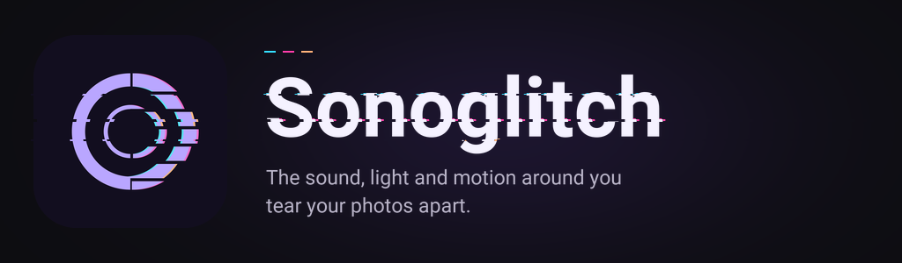

  

# Sonoglitch

[English](README.md) · [Español](README.es.md)

Sonoglitch es una cámara gratuita y de código abierto que deja que el entorno
dé forma a la foto. El nivel de sonido del micrófono, la luz del entorno
mezclada con el brillo de la imagen de la cámara y el movimiento de la escena y
del móvil alimentan un fragment shader en vivo: seis estilos convierten esas
tres lecturas en roturas digitales, ruido de cinta, resplandor de fósforo,
ondas, mapas de calor o dispersión prismática. Haz una foto, elige el recorte
y la composición, y guárdala en la galería o compártela con el menú del
sistema. **Gratis, sin anuncios, sin cuentas y sin acceso a la red.**

**Estado: desarrollo inicial, solo versiones alfa preliminares.** Aún falta
probar la compatibilidad, el rendimiento y la calidad de imagen en cada
dispositivo.

## Descargas

  
  <!--
  
  
  -->

Próximamente en Google Play y F-Droid.

<!--
## Capturas

  
  
  
  
  
  
  
  

Pulsa una captura para ampliarla.
-->

## Funciones

- Seis estilos, todos incluidos: Static, Tape, Phosphor, Ripple, Thermal y Prism.
- Tres entradas del entorno con el mismo significado en todos los estilos: ruido, luz y movimiento.
- Visor en directo con el efecto sobre la imagen: un botón de estilo con flechas (o un deslizamiento) cambia el estilo, y su panel de estilos describe cada estilo y ofrece Al azar y Según el lugar, que elige uno para el ambiente y te dice por qué.
- Disparo auto: la cámara hace la foto sola cuando el sonido supera un umbral tras un segundo de calma, o cuando la escena da un salto brusco.
- Tres composiciones de exportación: solo la foto, una banda de sonido con los valores medidos o un póster con el nombre del estilo.
- Cuatro recortes: la proporción original, un cuadrado 1:1 centrado, un vertical 4:5 centrado y un 9:16 para historias.
- Tres niveles de calidad: Estándar (hasta 2048 px en el lado largo), Alta (hasta 4096 px) y Máxima (hasta el tamaño nativo del sensor), según el tamaño del original y los límites del dispositivo. El tope de 24 megapíxeles se aplica a la foto recortada: la composición Sound strip añade su banda y el póster su marco y su pie, así que el archivo exportado puede ser algo mayor.
- PNG (sin pérdida) o JPEG, guardado en la galería o compartido con el menú del sistema.
- Mantén pulsada la foto para compararla con el original.
- Android 10 (API 29) o posterior.

## Cómo funciona

Todos los estilos leen las mismas tres entradas normalizadas:

| Entrada | Medición | Efecto |
| --- | --- | --- |
| Ruido | Nivel del micrófono, leído en memoria | La intensidad de la perturbación |
| Luz | Sensor de luz ambiente mezclado con el brillo de la imagen de la cámara | El tono y el contraste de la imagen |
| Movimiento | Desplazamiento de la escena entre fotogramas, más el giroscopio y el acelerómetro | Cuánto se mueve la imagen |

El sonido también se mide en tres bandas de frecuencias, en memoria, pero las
bandas solo se muestran en las composiciones de exportación: no cambian el
efecto de la foto. Las lecturas de sonido son relativas y dependen del
dispositivo, no son mediciones calibradas. El permiso de micrófono es
opcional; sin él, el ruido se queda en cero.

La pantalla de la cámara muestra los tres niveles en una tarjeta arriba. Al
tocarla se abre el panel **Cómo funciona**, que explica el ruido, la luz y el
movimiento con palabras sencillas, cómo se cambia el estilo y qué hace el
**Disparo auto**.

## Privacidad

La app solo lee el nivel de volumen del micrófono y la energía de tres bandas
de frecuencias, en memoria: el audio nunca se graba, almacena ni transmite.
El procesamiento es local, sin cuentas, sin anuncios, sin analítica y sin
servidores. Las versiones de publicación no declaran el permiso `INTERNET`,
así que la app no tiene acceso a la red.

Lee la [política de privacidad](docs/PRIVACY.md) para los detalles.

<!-- La política completa también se publica en la web:
https://dferrandizmont.github.io/sonoglitch/privacy/ -->

## Soporte

Sonoglitch es gratis, sin anuncios y sin cuentas. Las versiones de F-Droid y
de GitHub incluyen un enlace opcional a [Ko-fi](https://ko-fi.com/danielmfdev)
en Ajustes; la versión de Google Play no lo tiene, porque Play no permite
donaciones fuera de su propia facturación. Consulta [Releasing](docs/RELEASING.md)
para ver en qué se diferencian los canales.

## Licencia

Sonoglitch se distribuye con la licencia [Apache-2.0](LICENSE). Las
contribuciones usan la misma licencia.

---

La documentación técnica del proyecto está en inglés, en el
[README en inglés](README.md):

- [Build and run](README.md#build-and-run): requisitos, ejecución y compilación de un APK.
- [Diagnostics](README.md#diagnostics): el panel de diagnóstico y los informes.
- [Checks and contributions](README.md#checks-and-contributions): las comprobaciones de CI y cómo contribuir.
- [Project layout](README.md#project-layout): qué hace cada carpeta del repositorio.
