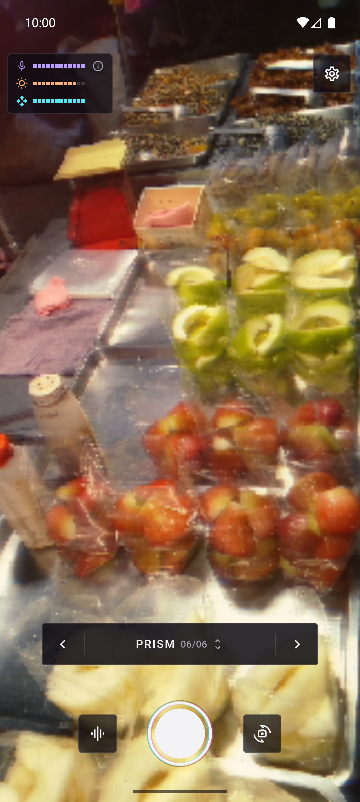
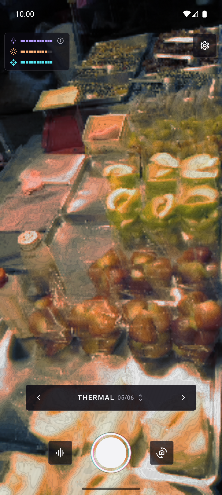
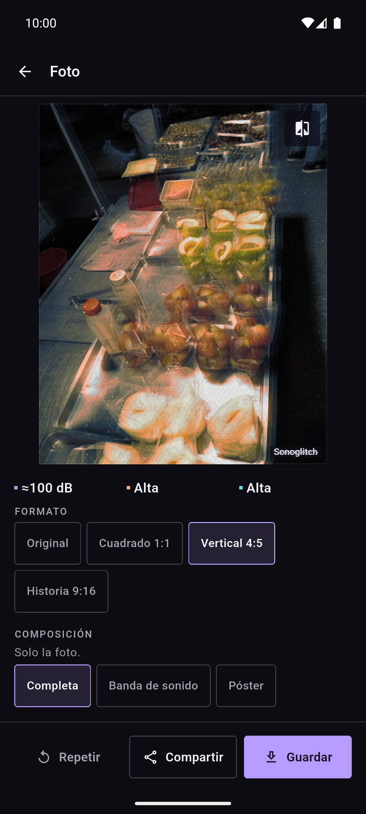
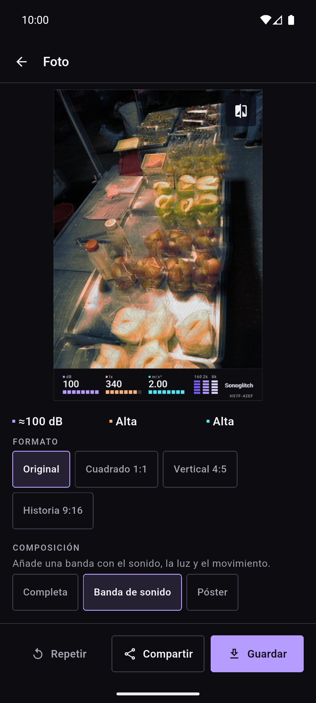
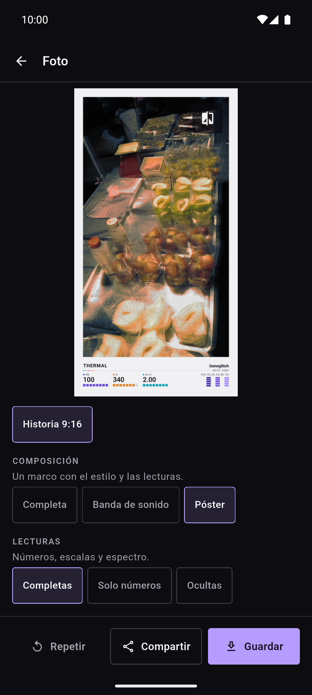
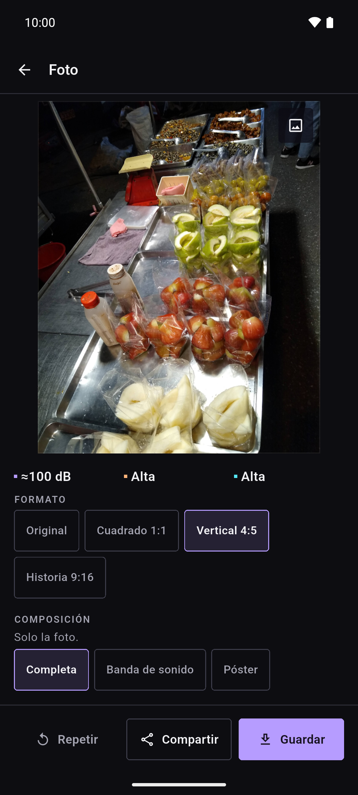
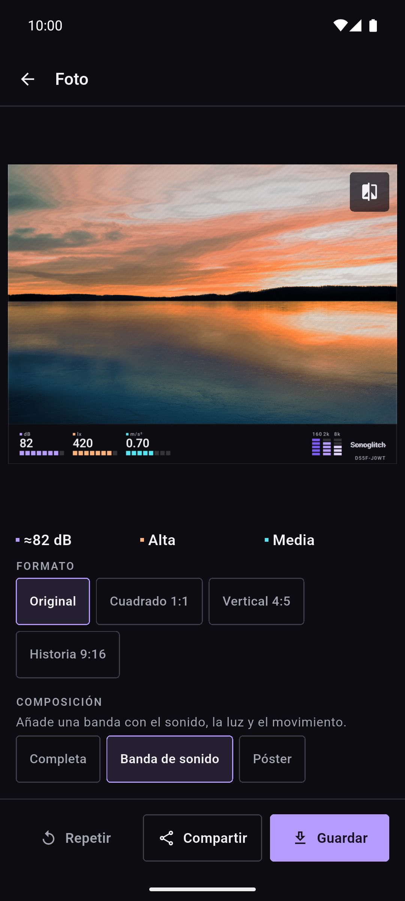

[English](README.md) · **Español**

  

# Sonoglitch

Sonoglitch es una cámara gratuita y de código abierto que deja que el entorno
dé forma a la foto. El nivel de sonido del micrófono, la luz del entorno y el
movimiento de la escena y del móvil alimentan un fragment shader en vivo: seis
estilos convierten esas tres lecturas en roturas digitales, ruido de cinta,
resplandor de fósforo, ondas, mapas de calor o dispersión prismática. Haz una
foto, elige el recorte y la composición, y guárdala en la galería o compártela.

**Gratis · Sin anuncios · Sin cuentas · Funciona sin conexión · Código abierto**

## Descargas

  
  <!--
  
  
  -->

Android ya, en Android 10 (API 29) o posterior; iOS todavía no está publicado.
La app está en una fase alfa temprana, así que solo se publican versiones de
prueba. Google Play y F-Droid llegarán más adelante. Aún falta probar la
compatibilidad, el rendimiento y la calidad de imagen en cada dispositivo.

Instala el APK desde GitHub

1. Abre la [página de versiones](https://github.com/dferrandizmont/sonoglitch/releases) y elige la prerelease más reciente.
2. Descarga `sonoglitch-<versión>.apk` y su archivo `.sha256`.
3. Comprueba el APK antes de instalarlo: `sha256sum -c sonoglitch-<versión>.apk.sha256` en Linux, `shasum -a 256 -c sonoglitch-<versión>.apk.sha256` en macOS o `Get-FileHash sonoglitch-<versión>.apk -Algorithm SHA256` en Windows, comparado con el hash del archivo `.sha256`.
4. Instálalo en el móvil, permitiendo aplicaciones de origen desconocido.
5. Comprueba la versión en **Ajustes > Acerca de**.

Algunas prereleases están firmadas con la clave de depuración en lugar de la
clave de publicación. Si el instalador no deja actualizar la app que ya tienes,
las firmas no coinciden: desinstala esa versión e instala esta otra.

## Capturas

  
  
  
  
  

Pulsa una captura para ampliarla.

Más capturas

  
  
  

## Funciones

El ruido marca la fuerza de la perturbación, la luz el tono y el contraste, y
el movimiento cuánto se mueve la imagen y las estelas que deja. Cada estilo
usa esas tres lecturas a su manera, y el efecto está acotado, así que el sujeto
sigue siendo reconocible.

- **Seis estilos.** Static, Tape, Phosphor, Ripple, Thermal y Prism.
- **Visor en directo.** El efecto ya está sobre la imagen; el botón de estilo o un deslizamiento lo cambian. El panel de estilos ofrece también **Al azar** y **Según el lugar**, que elige un estilo para el ambiente y te dice por qué.
- **Disparo auto.** La cámara hace la foto cuando el sonido supera un umbral tras un segundo de calma, o cuando la escena da un salto. En Android también puedes hacer la foto con los botones de volumen (Ajustes > Botones de volumen).
- **Tres composiciones de exportación.** Solo la foto, una banda de sonido con los valores medidos o un póster con el nombre del estilo.
- **Cuatro recortes.** La proporción original, un cuadrado 1:1 centrado, un vertical 4:5 centrado y un 9:16 para historias.
- **Tres niveles de calidad.** Estándar (hasta 2048 px en el lado largo), Alta (hasta 4096 px) y Máxima (hasta el tamaño nativo del sensor), según el tamaño del original y los límites del dispositivo.
- **PNG o JPEG.** Guardado en la galería o compartido con el menú del sistema. Mantén pulsada la foto para compararla con el original.

Más sobre los límites de calidad

El tope de 24 megapíxeles se aplica a la foto recortada: la composición Sound
strip añade su banda y el póster su marco y su pie, así que el archivo exportado
puede ser algo mayor.

## Privacidad

La app solo lee el nivel de volumen del micrófono y la energía de tres bandas
de frecuencias, en memoria: el audio nunca se graba, almacena ni transmite. El
procesamiento es local, sin cuentas, sin anuncios, sin analítica y sin
servidores.

[Política de privacidad](https://sonoglitch.mainshai.com/es/privacy/) · Web: [sonoglitch.mainshai.com](https://sonoglitch.mainshai.com/es/) · Soporte: **sonoglitch@mainshai.com**.

## Novedades

Consulta el [CHANGELOG.md](CHANGELOG.md) o las [versiones](https://github.com/dferrandizmont/sonoglitch/releases).

## Contribuir

Las incidencias, las ideas y las traducciones son bienvenidas. Cómo compilar,
probar y contribuir: [CONTRIBUTING.md](CONTRIBUTING.md).

Las versiones de GitHub y de F-Droid incluyen un enlace opcional a
[Ko-fi](https://ko-fi.com/danielmfdev) en Ajustes; la versión de Google Play no
lo tiene, porque Play no permite donaciones fuera de su propia facturación.

## Licencia

Sonoglitch se distribuye con la licencia [Apache-2.0](LICENSE). Las
contribuciones usan la misma licencia.
