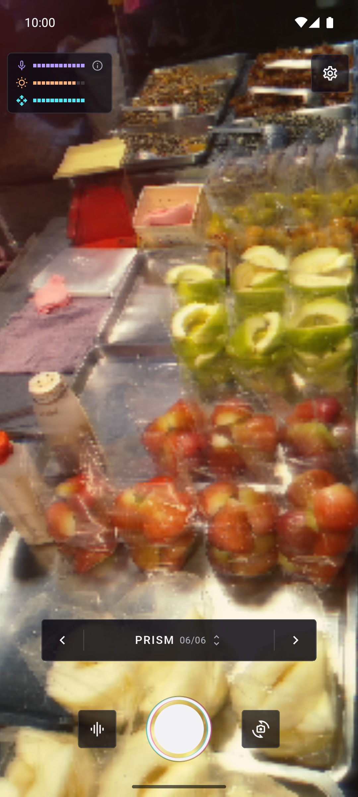
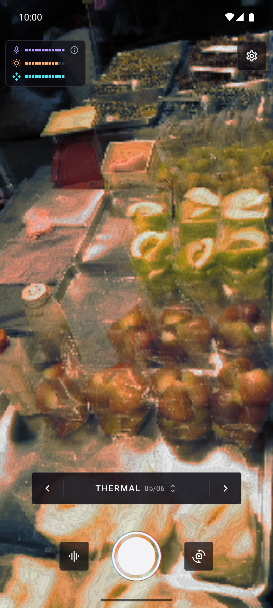
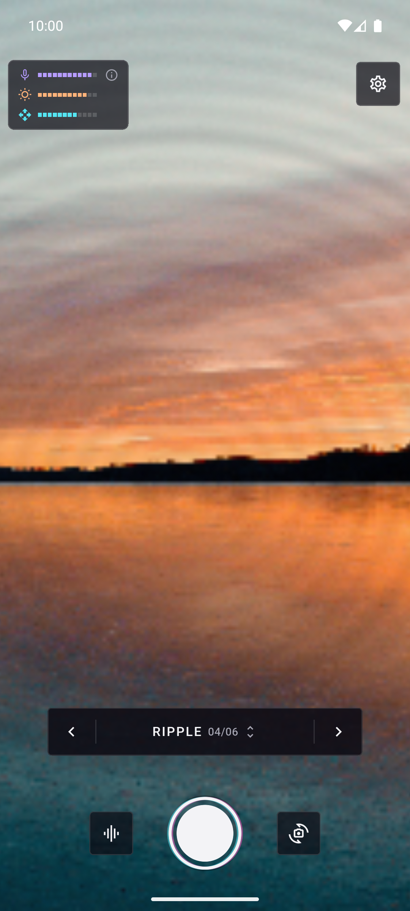
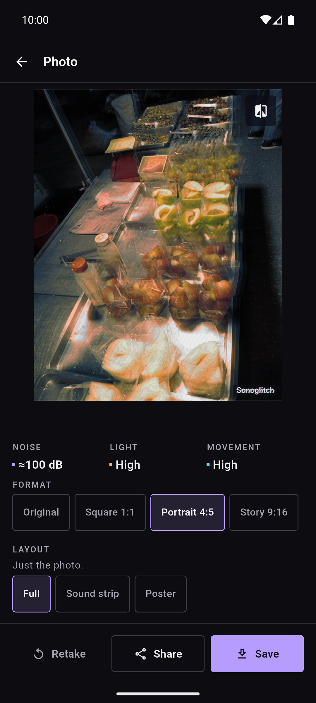
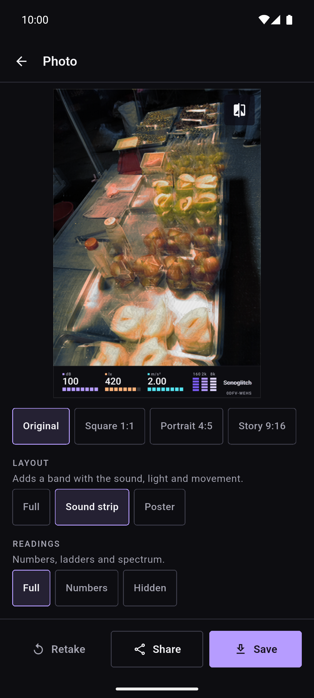
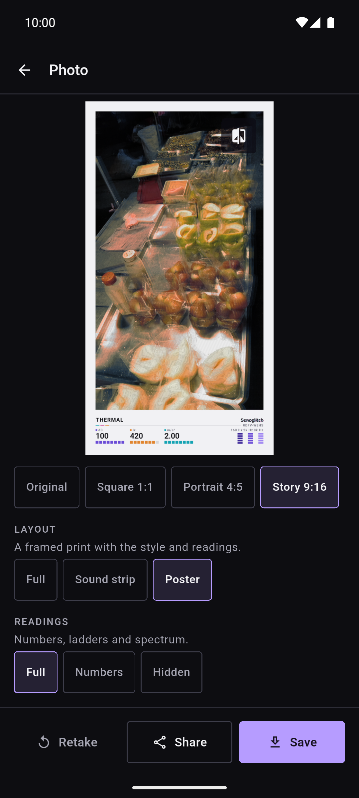
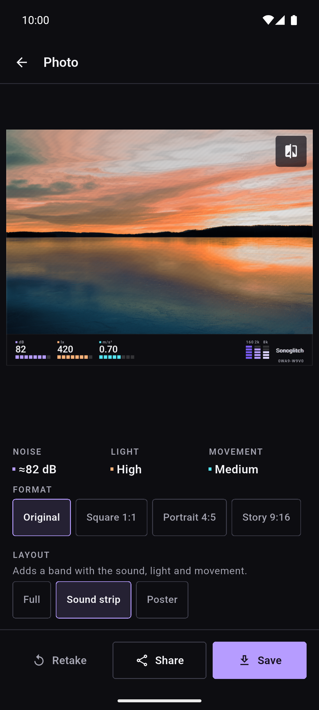

**English** · [Español](README.es.md)

  

# Sonoglitch

Sonoglitch is a free, open source camera app that lets the surroundings shape a
photo. The sound level of the microphone, the light of the place and the
movement of the scene and of the phone drive a live fragment shader: six styles
turn those three readings into digital tearing, tape noise, phosphor glow,
ripples, heat maps or prism dispersion. Take a still, choose a crop and a
layout, then save it to the gallery or share it.

**Free · No ads · No account · Works offline · Open source**

## Download

  
  <!--
  
  
  -->

Android now, on Android 10 (API 29) or newer; iOS is not released yet. The app
is at an early alpha stage, so only test builds are published. Google Play and
F-Droid will come later. Device compatibility, performance and image quality
still need testing.

Install the APK from GitHub

1. Open the [releases page](https://github.com/dferrandizmont/sonoglitch/releases) and pick the newest prerelease.
2. Download `sonoglitch-<version>.apk` and its `.sha256` file.
3. Check the APK before installing it: `sha256sum -c sonoglitch-<version>.apk.sha256` on Linux, `shasum -a 256 -c sonoglitch-<version>.apk.sha256` on macOS, or `Get-FileHash sonoglitch-<version>.apk -Algorithm SHA256` on Windows compared with the hash in the `.sha256` file.
4. Install it on your phone, allowing unknown apps.
5. Check the version in **Settings > About**.

Some prereleases are signed with the debug key instead of the release key. If
the installer refuses to update the app you already have, the signatures do not
match: uninstall that build and install this one again.

## Screenshots

  
  
  
  
  

Tap a screenshot to enlarge it.

More screenshots

  
  
  

## Features

Noise sets the strength of the disturbance, light the tone and the contrast, and
motion how much the picture moves and the trails it leaves. Every style uses
those three readings in its own way, and the effect stays bounded, so the
subject is still recognisable.

- **Six styles.** Static, Tape, Phosphor, Ripple, Thermal and Prism.
- **Live viewfinder.** The effect is already on the picture; the style button or a swipe changes it. The style sheet also offers **Random** and **Match this place**, which picks a style for the ambience and tells you why.
- **Auto shot.** The camera takes the photo when the sound crosses a threshold after a quiet second, or when the scene jumps. On Android the volume buttons can also take the photo (Settings > Volume buttons).
- **Three export layouts.** The picture alone, a sound strip with the measured values, or a poster with the style name.
- **Four crops.** The original ratio, a centred 1:1 square, a centred 4:5 portrait and a 9:16 story.
- **Three quality tiers.** Standard (up to 2048 px on the long side), High (up to 4096 px) and Maximum (up to the native size of the sensor), subject to the size of the original and to the limits of the device.
- **PNG or JPEG.** Saved to the gallery or shared through the system share sheet. Press and hold the photo to compare it with the original.

More about the quality limits

The 24-megapixel cap applies to the cropped picture: the sound strip adds a band
under it and the poster a frame and a caption, so the exported file can be
slightly larger.

## Privacy

The app reads only the microphone volume level and the energy of three frequency
bands, in memory: audio is never recorded, stored or transmitted. The
processing is local, with no accounts, no ads, no analytics and no servers.

[Privacy policy](https://sonoglitch.mainshai.com/privacy/) · Website: [sonoglitch.mainshai.com](https://sonoglitch.mainshai.com/) · Support: **sonoglitch@mainshai.com**.

## What's new

See [CHANGELOG.md](CHANGELOG.md) or the [releases](https://github.com/dferrandizmont/sonoglitch/releases).

## Contributing

Bug reports, ideas and translations are welcome. How to build, test and
contribute: [CONTRIBUTING.md](CONTRIBUTING.md).

The GitHub and F-Droid builds include an optional [Ko-fi](https://ko-fi.com/danielmfdev)
link in Settings; the Google Play build has none, because Play does not allow
donations outside its own billing.

## License

Sonoglitch is licensed under [Apache-2.0](LICENSE). Contributions use the same
license.
