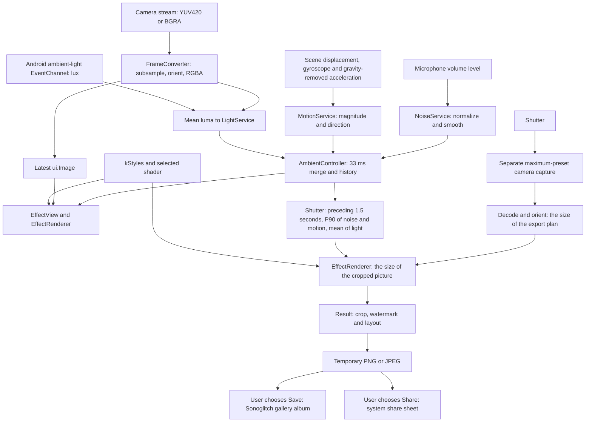

# Architecture

This document describes the current code, including limitations. Android is the primary target. iOS configuration targets iOS 16.0, but is not release-ready until verified on a Mac and physical device; see [IOS_STATUS.md](IOS_STATUS.md). The product goals in [SPEC.es.md](SPEC.es.md) extend beyond this implementation.

## Modules

| Module | Responsibility and entry points |
| --- | --- |
| `lib/ambient/` | `NoiseService` tracks levels, baseline and bursts; `LightService` blends `AmbientLightSource` lux and frame brightness; `MotionService` fuses scene displacement, the gyroscope and the accelerometer. `AmbientController` publishes smoothed `AmbientState`, retains a short history and supports manual overrides. `AmbientConfig` holds constants. |
| `lib/camera/` | `CameraService` owns controllers, stream and still capture. `FrameConverter` converts raw planes; `raw_frame.dart` provides testable data types; `exif.dart` parses still orientation. `CameraMetrics` tracks conversion throughput. |
| `lib/effects/` | `kStyles` in `style_definition.dart` lists the six selectable shaders; `kRegisteredStyles` also holds the recipes that are still in development. `EffectRenderer` loads, paints and renders stills; `EffectView` drives live repaints; `cover_uv.dart` computes cover-fit texture coordinates. |
| `lib/export/` | `ExportFormat` defines crops; `ExportQuality` and `ExportPlan` size the export; `ExportLayout` adds the sound strip or the poster around the picture; `ExportService` composes a crop/watermark, encodes PNG or JPEG, saves to the gallery or invokes system sharing. |
| `lib/features/` | Onboarding permissions; viewfinder/capture coordination; style selection; result/crop/save/share; persisted Settings. `StyleController` manages the selected renderer. The viewfinder uses square overlay controls and a segmented style rail with previous/next arrows, a style name and a counter. The rail opens the style sheet (`style_sheet.dart`), and the `How it works` sheet (`level_legend.dart`) explains the three controls; `styles_screen.dart` lists the same registry for the full screen route. |
| `lib/debug/` | Rotating local `DebugLog`, `DebugHud`, device summary, capture timings and JSON diagnostic reports/export. |
| `lib/theme/` | `AppTheme` defines shared UI colors, typography, spacing and shapes. |
| `lib/l10n/` | English/Spanish ARB resources and generated Flutter localization classes. |

`lib/main.dart` initializes logging, preferences and services, injects them into `SonoglitchApp`, locks the UI to portrait and wires routes from `lib/routes.dart`. `lib/app_config.dart` holds build-time display version, diagnostics defaults, donation URL and app constants. State uses Flutter notifiers, injected services and streams.

## Data flow

### Ambient inputs

- `NoiseService` consumes `NoiseMeter` mean-decibel readings. The absolute component maps the level to 0–1 between an adaptive quiet floor and an adaptive ceiling. The floor starts at 58 dB and follows the P10 of the last three minutes of readings, clamped to 45–70 dB and adapted over three minutes; the ceiling starts at 72 dB, rises with the loudest reading and decays back to it over ten minutes of quiet, never dropping below the floor plus 15 dB. Between the two, the curve is a power of 1.6. A baseline starts as the first second's mean, then follows a slow 20-second exponential filter. The target combines the absolute level with weight 1.0 and the level above baseline with weight 0.35 (full scale at 20 dB above it), taking the maximum of this blend and a separate burst envelope. Bursts start above baseline + 8 dB, scale over another 18 dB and decay slowly enough to make brief claps visible. Only level numbers enter the app's ambient state; the microphone dependency processes transient audio buffers in memory before reducing them to levels. The app does not write or share those buffers. If microphone permission is declined, the service is disabled and measured noise stays at zero. These are relative, device-dependent readings; real-device microphone calibration is unverified.
- `LightService` receives mean sampled luma from conversion, divides by 255 and applies smoothstep. On Android, `EventChannelAmbientLightSource` subscribes to `sonoglitch/ambient_light` for hardware lux readings. Lux maps to `clamp(log10(lux + 1) / 4.5, 0, 1)` and contributes 75% of the target, with image brightness contributing 25%. Missing/unavailable/erroring sensors fall back to image brightness alone, as does iOS. Camera exposure affects the image component. No additional light-sensor permission is requested.
- `MotionService` fuses three sources: the displacement of the scene measured between consecutive preview frames, the gyroscope and the gravity-removed accelerometer. Each one is smoothed and mapped to 0–1 on its own scale (the accelerometer over 20 m/s², the gyroscope between 0.15 and 2 rad/s and the scene between a luma residual of 2 and 25), and the strongest of the three sets the level, with the accelerometer weighted at 0.8. The direction comes from the source that wins: the scene displacement vector, the gyroscope axis or the accelerometer axes.

`SmoothedValue` uses exponential smoothing with separate attack/release constants. Noise settling durations are 100 ms for the fast reading, 60/1200 ms for bursts and 80/500 ms for the final output; `AmbientConfig.timeConstant` divides these by three to obtain the exponential constants. The baseline uses a 20-second constant directly. Light uses 150/400 ms, motion magnitude 120/500 ms and direction 400/600 ms. `AmbientController` merges every 33 ms and keeps at most 240 samples. In automatic mode, the shutter freezes the samples of the preceding 1500 ms: the P90 of the noise, the P90 of the motion and the mean of the light. The direction and the motion diagnostics come from the sample selected by the motion P90, so opposing movements do not cancel each other; an empty history falls back to current state.

The diagnostics panel has a manual switch and noise/light/motion sliders. `--dart-define=SONOGLITCH_MANUAL=0.9,0.1,0` initializes them at build time, in that order. Exactly three finite values are required, clamped to 0–1; malformed input is ignored. Manual mode overrides published controls and capture snapshots return those values directly, without historical averaging. Manual state has no measured motion direction. Sensor subscriptions still start while the viewfinder is active; manual mode does not disable them.

### Camera and rendering

The live controller uses `ResolutionPreset.medium`, with audio disabled. Android frames use YUV420 and iOS frames BGRA8888. `FrameConverter` directly subsamples planes into an upright RGBA buffer with a longest side of at most 360 pixels; it computes mean luma in the same pass. Rotation and front-preview mirroring are handled by the camera pipeline. The RGBA buffer is decoded to a `ui.Image`, published through a `ValueNotifier`, then sampled by the selected fragment shader.

`CameraService` serializes initialization, switching, pause/resume, capture and disposal through one operation queue. Disposal sets a flag and advances a generation counter immediately; a controller that finishes opening after disposal is released instead of published. The viewfinder combines route visibility and app foreground state: when hidden, it pauses streaming, rejects new frame conversions and stops ambient sensors and the preview clock. The camera remains open for resuming. Hidden viewfinders also pause the native preview independently of image analysis. Superseded resumes do not restart analysis. The plugin adapter invalidates frame delivery immediately on stop, then waits for the first frame as evidence that asynchronous analyzer installation has completed before canceling the subscription; without that frame, shutdown remains pending rather than racing a late installation. Unsupported preview operations are ignored quietly. Operational failures are logged and leave the applied preview state unknown, so another request can retry reconciliation. Resume retries once, then closes and reopens the live controller if it still fails. A controller whose initialization fails is released, including failures after partial opening. A conversion already in flight may finish, but its image is disposed without publication if its stream generation is stale, even after a pause and resume. Returning to the viewfinder restarts the stream and sensors; ambient history is cleared when hidden.

`EffectView` uses a `CustomPainter` listening to ambient state and an animation ticker; camera-image changes also update the view. The image is cover-fitted using texture scale/offset uniforms, with final texture coordinates clamped. Static adds digital bands/tearing, Tape adds tracking/wobble/grain, Phosphor adds the scan lines, grille and persistence of a CRT tube, Ripple adds a traveling wavefront with a refracted crest, Thermal adds a heat map with isotherm contours, and Prism adds flowing warp/dispersion. The three inputs keep the same general meaning in every style, but each style uses them in its own way. Static, Tape and Prism displace the pixels and split the color channels with the noise, grade the tone and the contrast with the light and smear the picture along the direction with the motion. Ripple drives its wavefront with the noise, tints the crest with the light and stretches the wavefront and smears the picture with the motion. Phosphor sets the glow, the scan lines and the snow with the noise, shifts the tube between green shadows and soft whites with the light and bends the picture into a barrel, holds it and leaves green afterimages with the motion. Thermal shifts the palette and the contours with the noise, separates the isotherms with the light and offsets the picture along the direction with the motion. Trails sample offsets within one image; no previous-frame accumulation is implemented.

### Still capture and export

`ViewfinderScreen._capture` snapshots the ambient state and the preview animation clock before acquiring the still. `CameraService` closes the live controller, opens a `ResolutionPreset.max` controller with audio disabled, takes the encoded still, then attempts to restore the live stream. A failure in the high-resolution path attempts capture with the restored live controller if available.

The exported picture is planned before anything big is allocated. `ExportPlan.build` reads the oriented size of the camera original and returns the crop and the decode dimensions: the quality tier caps the longest side (2048 px for Standard, 4096 px for High, the native side for Maximum), the crop is kept under 24 megapixels, and the whole plan stays inside the texture limit the GPU accepts. `PhotoExporter` probes that limit with small render targets and lowers the plan when the decorated output does not fit. The compressed original is decoded straight into the planned dimensions, cropped and drawn through the same shader contract with `EffectRenderer.renderToImage`, so the render is the size of the crop. EXIF orientation, sensor orientation and a portrait-aspect heuristic determine rotation/mirroring. This uses a separate still image, not a widget screenshot; scene timing and crop can differ from the live preview.

The result screen composes the original aspect ratio first and can switch to a centered 1:1, 4:5 or 9:16 crop. `ExportService` draws the selected crop plus an optional `sonoglitch` watermark, adds the chosen layout and encodes the result as PNG or JPEG into the app temporary directory. The layouts add room around the picture instead of shrinking it: the sound strip adds a band under it and the poster adds a frame and a caption, so the exported file can be slightly larger than the 24-megapixel cap of the picture itself. This temporary file is written while preparing the result, before Save or Share. Only the latest requested composition is applied; export buttons wait for the selected configuration to finish composing. Full-resolution work is serialized, and a cache hit supersedes pending work immediately. A screen-owned LRU retains at most four encoded temporary files and four previews capped at 1024 pixels per side (16 MiB of RGBA surfaces); full-resolution composed images are released after making the preview. The key includes capture identity (source, effect and ambient values), format, layout, readings mode, watermark, file type, quality and original/processed variant. Compare remains display-only and never changes the exported processed variant. Settings notifications refresh watermark, file type and quality while the screen is open. Save calls `Gal.putImage`; the album `Sonoglitch` is only requested when the system can create it without a storage permission, which on Android means from Android 11, so Android 10 saves the picture without an album. Share passes the file to the system share sheet. Save and Share retain their encoded cache entry for reuse. Eviction, Retake, capture replacement and disposal attempt to delete owned files and dispose cached images. Retake keeps only a separately owned small image handle for the route's closing animation, then releases it on disposal. The comparison uses a separately owned original decode and crop, each capped at 1024 pixels per side (up to another 8 MiB); crop generations reject late results, and pending crops retain their input handles until they settle.

The sound strip and the poster have a readings mode (`ExportReadingsMode`): `full` prints the numbers with their little square ladders and the spectrum ladders, `numbers` prints only the numbers and their labels, and `hidden` prints no readings. The style name, the watermark, the photo ID and the context line stay in every mode, and the full layout ignores the mode. The mode travels in `ExportLayoutValues.readingsMode`, so the preview, Save and Share share one contract. `ExportLayoutPlan.resolveMode` shrinks the band (15.5%, 13.5% or 7.5% of the shorter side) and the poster caption (21%, 18% or 11%) to the content that remains. The mode belongs to the result cache key, so changing it re-renders from the cached effect without computing it again, and it is persisted in `AppSettings` like the layout. The result screen shows the selector only for the strip and the poster, and a square-cell `GlitchLoader` replaces the round spinner while the picture is processed.

Both high-resolution and fallback capture paths attempt to delete the camera-created still file in `finally`, including when reading or decoding fails. Deletion is best effort and logs a warning on failure. Startup cleanup removes top-level `sonoglitch_` temporary files older than 24 hours; this does not guarantee cleanup of arbitrary camera-plugin filenames or every private cache file.

## Capture signature foundation

`lib/ambient/signature/` owns immutable `SignatureState`, `CaptureSignature` and `CaptureIdentity`, the one-shot `PendingCaptureSignature`, `SignatureController`, and ephemeral `SignatureSource`/`SignatureReading`. It adds no timers, storage, network requests or PCM access. Its delivery-2 producers (`SignatureSignals`, `HeadingService`, `RhythmTracker`, `SpectralTiltFilter`, `SceneColorFilter` and `CalendarSignature`) add one optional magnetometer subscription, which needs no permission, and reuse the gravity of the motion service and the raw bands of the spectrum service: no second stream is opened for them. `crypto 3.0.7` is a direct dependency for HMAC-SHA256; it was already locked transitively and its license is BSD-3-Clause.

A fresh 32-byte `Random.secure()` nonce is prepared per pending photo. Domain-separated HMAC-SHA256 derives the stable macro seed (`sonoglitch/pattern/v1`) and provisional microtexture (`sonoglitch/preview-micro/v1`). At the shutter, `AmbientController.snapshot()` consumes it once with `sonoglitch/capture/v1`, preserving P90 noise/motion and mean light while freezing the latest published filtered bands. It returns an immutable state carrying `captureSignature` and `identity`, then publishes a new pending photo. Rotation and seed copies preserve that identity. The nonce and mutable derivation buffers are cleared best effort; managed-memory secure erasure is not guaranteed.

The v1 big-endian binary message contains a version, session shot counter, UTC and monotonic microseconds, recipe version, length-prefixed UTF-8 style ID, reading count, presence/freshness masks, and per-reading age and low mantissa byte. Canonical channel order: linear acceleration x/y/z, gyro x/y/z, scalar microphone dB, scalar bass/mid/treble energies. Only the low eight float32 mantissa bits of the latest finite events are sampled. Missing, backward-clock and older-than-1500-ms readings are not fresh; stale bytes are excluded. Source ages use their injected monotonic clocks. Stop clears their transient material. Randomness is the main entropy source; sensor entropy and physical clock resolution are not guaranteed.

`sonoglitch/photo-id/v1` derives exactly eight Crockford Base32 characters (`0123456789ABCDEFGHJKMNPQRSTVWXYZ`) from 40 bits. Example: `7K3M9Q2D`. This is a visual reference, with possible collisions, not a global identifier. Each shot gets a new signature and bounded visual variation; identical final images remain possible, especially after clipping or JPEG. Crop/quality changes and reexports retain the capture's existing ID and inputs.

`CaptureResult` already retains the immutable ambient state. Import `ambient/signature/capture_identity.dart` to access its `identity` and `captureSignature` extension getters without editing result/export-owned files. Legacy/test inputs return null. Export's owner forwards `identity?.photoId` to `ExportLayoutValues.photoId`; no ID is derived during composition. Freezing the actual renderer and moving the shutter snapshot before haptics/awaits is the separate D1.4 integration step.

Seeds, fingerprints, photo IDs and derivation material are excluded from ambient JSON and diagnostics/HUD. The contextual lanes (warmth, hue, chroma allowance, tilt, orientation axis and pulse) follow the same rule: they are sampled in memory, frozen at the shutter and never serialized, logged or added to the cache key. Existing scalar diagnostics are unchanged. Never add serialization, logging, seed import or replay for signature material. Tests inject randomness and both clocks; production must use secure randomness. Real GPU compilation, helper invalidation, rendering neutrality and perceptual/device checks remain integration gates.

## Contextual signals (delivery 2)

`lib/ambient/signature/signature_signals.dart` owns `SignatureSignals`, the service that aggregates the producers of the contextual lanes behind one injectable class: the local wall clock, the shared gravity of the motion service, the magnetometer of the device and the raw bands of the spectrum service. Every dependency is injected, so the pipeline runs with fake sensors and a fake clock in the tests.

The eight lanes, their source signals, their producers, their update rates, their ranges, their neutral values and their freeze at the shutter are tabulated in **Delivery 2: contextual signature modulations** below.

The lifecycle is the one of the other ambient services: `AmbientController.start()` starts the producers and `stop()` cancels the magnetometer input and drops every transient value, so a new session begins with the neutral lanes. The merge tick calls `SignatureSignals.update()` at about 30 Hz: the civil palette is refreshed at about 1 Hz and the raw spectrum of the session is drained, without subscribing to the native stream again. The spectrum service keeps every native reading in a bounded queue, and the lanes drain it in order, so several readings between two ticks reach the rhythm tracker and the tilt filter as they arrived instead of collapsing into the last one; the latest reading is polled as well and deduplicated by timestamp. The phase correction of the tracker measures its error at the instant of the attack and not at the last emitted bin, so the peak of the pulse lands on the attack. The scene colourfulness is measured by the frame conversion itself: `FrameConverter` accumulates the statistics over the sparse grid of `sceneSamplePoints` while it writes the pixels, computing the coordinates of the grid arithmetically instead of building a list of points for every frame, and `CameraService` forwards the result to `SignatureSignals.addScene` with the clock of the pipeline. The pixels are not retained. A lens change, a camera restart or a pause clears the scene filter, so a camera never lends its colours to the next one.

The lanes are frozen at the shutter, synchronously and before any await, exactly like the fingerprint: `AmbientController.snapshot()` reads the current lanes, merges them into the capture signature with `withMood` and returns an `AmbientState` that carries the `CaptureSignature` with them. The decode, the crop, the export and the recomposition of that picture always use those values, and `forPhotoTurns` keeps them (a mirrored image negates the axis `y` lane). The state published after the shot is the next pending one, with the current lanes. In the manual mode the lanes are neutral, so a screenshot or a test of the effects is reproducible.

Privacy: the lanes are sampled in memory and never stored, logged or sent. They are not part of `AmbientState.toJson`, the diagnostics, the "Copy report" or the key of the result cache; that key already holds the capture, and the capture holds the frozen lanes with the photo identity. No new permission and no new dependency were added: the magnetometer needs none.

The wording is honest: these are aesthetic modulations from approximate signals, not measurements. The chroma allowance reduces the chroma the effect may add and never desaturates the original; the limits of every lane are listed with the recipes below.

## Shader uniform contract

The float declaration order in every `shaders/*.frag` must match the binding order in `lib/effects/effect_renderer.dart`:

| Float indices | Declaration | Value |
| --- | --- | --- |
| 0–1 | `uniform vec2 uSize;` | Output pixel width/height |
| 2 | `uniform float uNoise;` | Finite, clamped 0–1; fallback 0 |
| 3 | `uniform float uLight;` | Finite, clamped 0–1; fallback 0.5 |
| 4 | `uniform float uMotion;` | Finite, clamped 0–1; fallback 0 |
| 5 | `uniform float uTime;` | Seconds, clamped 0–1,000,000; fallback 0 |
| 6–7 | `uniform vec2 uMotionDir;` | Normalized stable direction, fading near zero; invalid vectors become zero |
| 8–9 | `uniform vec2 uUvScale;` | Cover-fit scale in texture coordinates |
| 10–11 | `uniform vec2 uUvOffset;` | Cover-fit offset in texture coordinates |
| 12 | `uniform float uBass;` | Energy of the bass band, 0–1 |
| 13 | `uniform float uMid;` | Energy of the mid band, 0–1 |
| 14 | `uniform float uTreble;` | Energy of the treble band, 0–1 |
| 15 | `uniform float uSeed;` | Procedural pattern seed, 0–1, frozen for a capture |
| 16-19 | `vec4 uFingerprint` | Four independent 24-bit fractions; neutral `(0, 0, 0, 0)` |
| 20 | `vec4 uMood` (x) | Time-of-day warmth: cold night -1, warm evening +1; neutral 0 |
| 21 | `vec4 uMood` (y) | Calendar and moon hue, -1..1; neutral 0 |
| 22 | `vec4 uMood` (z) | Chroma allowance: how much chroma the effect may add, 0.65..1; neutral 1 |
| 23 | `vec4 uMood` (w) | Spectral tilt: -1 dark and bassy, +1 bright and hissy; neutral 0 |
| 24 | `vec4 uSign` (x) | Orientation axis cos(delta), a unit vector; neutral 1 |
| 25 | `vec4 uSign` (y) | Orientation axis sin(delta), a unit vector; neutral 0 |
| 26 | `vec4 uSign` (z) | Rhythmic pulse = confidence * cos(phase), signed; neutral 0 |
| 27 | `vec4 uSign` (w) | **Reserved** for the barometer, not implemented; neutral 0 |

`uniform sampler2D uImage;` is **sampler 0**, separate from float indices. Shaders use `FlutterFragCoord().xy / uSize`, aspect correction for trails and cover mapping before clamping samples. Geometry is resolution-independent. The ABI has exactly **28 consecutive floats** (no std140 padding) and separate sampler 0. Every paint overwrites all 28 values. Nonfinite fingerprint lanes become zero and finite lanes are clamped to 0–1. The contextual lanes are sanitised the same way: a nonfinite value falls back to its neutral, `warmth`, `hue`, `tilt`, `pulse` and the reserved lane clamp to -1..1, `chromaAllowance` clamps to 0.65..1, and the orientation axis is normalised to unit length, falling back to the neutral `(1, 0)` when it is nonfinite or shorter than 1e-6. The neutral contextual values are `uMood = (0, 0, 1, 0)` and `uSign = (1, 0, 0, 0)`; with them every style reproduces the delivery-1 pixels exactly. A small rotation is mirrored with the image, so `forPhotoTurns(mirrorX: true)` negates the sign of the axis `y` lane while plain quarter turns leave it unchanged. All six selectable styles consume spectrum, seed and fingerprint through the SIG-2A (Static, Tape, Prism) and SIG-2B (Phosphor, Ripple, Thermal) recipes below. Hidden styles preserve their existing recipes. New styles require a registry entry and `.frag` registration under `flutter.shaders` in `pubspec.yaml`.

`shaders/signature_common.glsl` provides pure, guarded helpers with no uniforms or version directive: aspect-correct coordinates, total displacement clamping (5% of the short side), original preservation (at least 45%), arithmetic hashing, and final microtexture bounded to one RGB8 code per channel. An all-zero fingerprint is an exact bypass. The recipes call these helpers only on the signature path; their zero-band/zero-seed path preserves the legacy recipe before any final microtexture. Flutter 3.47.7 passes the input shader directory as an include path and emits include dependencies; only the twelve `.frag` entry points are registered.

## Signature modulations

SIG-2A covers **Static, Tape and Prism only**. All ranges below are inclusive. Inputs are bound by the existing twenty-eight-float renderer for both viewfinder and still rendering; the shader has no history, random source or alternate capture path. The pending-shot seed stays fixed while bands can update live; capture uses frozen inputs. No `lib/` or shared helper changes are part of these recipes.

| Parameter, source and range | Static | Tape | Prism |
| --- | --- | --- | --- |
| `uNoise`, main control, 0..1 | Gates jitter by `n^0.75`, tears by `smoothstep(.25,.65,n)`, blocks by `smoothstep(.60,1,n)`; triangle and fine grain also multiply `n`. | Same gates; tracking multiplies the tear gate. | Same gates; dispersion multiplies onset/tear/corruption. |
| `uLight`, main control, 0..1; neutral .5 | Legacy cold shadow contrast/grain/vignette below .5, warm wash/bloom/leak above .5. | Same structure, with the existing faded analog constants. | Same structure, with the existing saturated dispersion constants. |
| `uMotion`, main control, 0..1 | Trail response `m^0.65`, length `.095*response` short sides, six weights `.30/.18/.16/.14/.12/.10`. | Same response/weights; length `.12*response`. | Same response/weights; length `.105*response`. |
| `uMotionDir.xy`, normalized sensor direction, components -1..1, length <=1 | Multiplies the one-sided trail; shader negates y for UV coordinates. Spectrum never replaces it. | Same. | Same. |
| `uBass`, filtered low-band energy, 0..1 | Triangle `1-4*abs(fract(y*1.5+seed)-.5)` adds at most `+/-.003*bass*noise` short sides to x warp. | Existing tracking sine and constant exponent 10 are reused; amplitude `.012*(1+.15*bass)` and spatial width multiply 1..1.15, by dividing frequency by `1+.15*bass`. | Existing axis sine is reused; frequency `7/(1+.15*bass)` (7..6.087), angle amplitude `.55*(1+.15*bass)` (.55 to .6325 radians). |
| `uMid`, filtered middle-band energy, 0..1 | Band density `47*(1+.15*mid)` (47..54.05); block density follows within raster cap. | Band density `31*(1+.15*mid)` (31..35.65); tracking sine frequency `22*(1+.15*mid)` (22..25.3 before the bass width divisor). | Band density `41*(1+.15*mid)` (41..47.15); block density follows within raster cap. |
| `uTreble`, filtered high-band energy, 0..1 | Row density 240..276; jitter and RGB split multiply `1+.15*treble`. Grain amplitude <=`.004*noise*treble` before final retention. | Row density 180..201.6; jitter/chroma split multiply `1+.12*treble`. Fine hiss uses the same .004 bound. | Row density 210..241.5; jitter and RGB split multiply `1+.15*treble`. Fine texture uses the same .004 bound. |
| `uSeed`, pending-shot macro seed, 0..1 | Row/hash clock offset `97*s`, band cell offset `13*s`, block phase `7*s`, block column `5*s`, broad triangle phase `s`; fine arithmetic hash uses s, grade grain offset `(31,17)*s`. No amplitude added. | Same hash/band/block/grain offsets; tracking phase `2*pi*s`. | Same hash/band/block/grain offsets; slow dispersion phase `2*pi*s`. |
| `uFingerprint.x`, per-shot fraction, 0..1 | Independent red microtexture hash seed; <=1 RGB8 code including shared w. | Same. | Same. |
| `uFingerprint.y`, per-shot fraction, 0..1 | Independent green microtexture hash seed with cell offset (17,0); same bound. | Same. | Same. |
| `uFingerprint.z`, per-shot fraction, 0..1 | Independent blue microtexture hash seed with cell offset (0,29); same bound. | Same. | Same. |
| `uFingerprint.w`, per-shot fraction, 0..1 | Shared zero-mean microtexture added to all three lanes; each lane and w contribute at most .5/255, total <=1/255/channel. | Same. | Same. |
| `uTime`, animation seconds, 0..1,000,000 | Pattern clock `floor(t*18)`; blocks `floor(t*36)`. Seed only offsets phase; bands never multiply time. | Pattern 12 Hz, blocks 24 Hz; tracking phase `-.27*tick`. | Pattern 24 Hz, blocks 48 Hz; axis phase `+.13*tick`. |
| `uSize.xy`, output dimensions, >0 | Aspect position `(uv-.5)*size/min(size)`; convert displacement back with `min(size)/size`. Block raster reservation prevents aliasing above the area cap. | Same. | Same. |
| `uUvScale.xy`, cover-fit scale, 0..1 | Sampling only: `uv*scale+offset`, clamped to the texture. No pattern amplitude. | Same. | Same. |
| `uUvOffset.xy`, cover-fit offset, 0..1 | Sampling only; no random or temporal contribution. | Same. | Same. |
| `uImage`, camera texture, RGB 0..1, sampler 0 | Source for original, warped channels, trails and bloom; clamped cover sampling. | Same. | Same. |

For nonzero bands or seed, a single conservative radius `length(warp)+length(split)+length(fullTrail)` is clamped with `signatureLimitOffset`. Scaling all three vectors together guarantees **every channel and every trail tap stays within 5% of the short side**, including their combination. Bloom samples are separately within 1.2% of the short side. The original center tap is reused by `signatureRetainOriginal` **after grading and flashes**, retaining at least 45% of untouched original RGB before the final microtexture. The pre-retention fine grain is at most .004; at neutral light its final contribution is at most .0022. Light grading can transform it, but the final original-preserving mix still applies.

Mid changes physical band width inversely with density: duty stays fixed. Damaged-block density is capped at `min(BAND_COUNT*(1+.15*mid), max(1,floor(height/32)))` and duty at `min(.16,max(0,.20-blockBands/height))`; the reserved raster row keeps continuous+raster coverage <=20%. Horizontal gaps only reduce coverage. Existing flashes remain thin, multiplicative and <=18% before the final preservation mix. Base warp/split constants are unchanged; the full combined budget can attenuate them at extremes.

**Compatibility exception:** with bass, mid, treble and seed all zero, a uniform branch calls the historical recipe with unchanged constants and arithmetic. This path retains the old displacement/trail behavior rather than imposing a new budget that would change legacy pixels. All-zero fingerprint bypasses microtexture exactly. Fingerprint alone does not activate the new macro recipe or budgets: replacing the provisional preview fingerprint at the shutter changes only bounded microtexture, not band placement. It uses normalized UV cells (`floor(uv*4096)`) and four independent arithmetic hashes. This follows the architecture's stable macro seed / per-shot microtexture split; fingerprint intentionally does not move large-scale features.

Static's new geometry uses only a triangle wave; Tape and Prism reuse their existing sine counts. Signature-only sampling, grading and preservation use no new texture taps: **at most 28** for each style (six positions * four taps + four bloom neighbors), with mutually exclusive legacy/signature branches. Estimated incremental scalar arithmetic including four fingerprint hashes: Static **180..300 ALU**, Tape **185..310**, Prism **185..315**; these are source-level estimates, not GPU instructions or timings. Keeping the historical path callable increases shader source/code size; uniform branching and register pressure need device measurement.

`test/effects/signature_stp_test.dart` performs real `FragmentProgram` renders, compares explicit-zero inputs byte-for-byte, locks historical source arithmetic independently with SHA-256, checks each band's response, equal-input determinism, fingerprint lane diversity and <=1 RGB8 deviation, and sweeps four seeds/four band scenarios over the existing high-frequency texture and coherent synthetic scene (including portrait geometry). It requires low-resolution luminance correlation >=.85 against the original, pairwise seed MAE >=1 RGB8 and mean-centered spatial residual >=.5 RGB8. It prints per-style measured minima for review. Measured minima (correlation >= 0.986; seed MAE on the synthetic fixtures 2.0 / 1.4 / 2.3 RGB8 for Static / Tape / Prism; the photographic scene is mostly saturated or dark and keeps a lower floor of 0.1 RGB8, measured 0.14 / 0.12 / 0.26) are the basis of the floors. Seed-to-seed differences are subtle (a few RGB8 levels): tune strength on a real phone. There are no versioned real photographic fixtures under `test/effects/`; licensed photo coverage remains an integration gap. Runtime compilation failures must fail visibly, not skip to CPU approximations. If stale shaders are served, the lead must remove `build/unit_test_assets` before rerunning.

On a real phone, compare frame-time **p50/p95 against alpha.14 in the same scene**, with identical resolution, light, motion and noise settings. Check maximum still dimensions, portrait/landscape/front mirroring and crops, face/text recognition, silence/bass/mid/treble, seed layout stability across the shutter, neutral/fingerprint-only captures and JPEG loss of microtexture. Compile success and constant texture reads do not establish performance or recognition.

SIG-2B changes Phosphor, Ripple and Thermal only. All ranges below assume the renderer's finite, clamped 28-float contract. `n` is noise, `m` is motion; `TAU` is one cycle. A width unit converts to UV by `(1, width/height)` and is aspect-correct. Every signature-path sample then clamps its **total** UV offset to 0.05 of the short side. Thus the legacy width-unit amplitudes below cannot exceed the shared displacement budget, including landscape frames.

| Parameter (source/range) | Phosphor | Ripple | Thermal |
| --- | --- | --- | --- |
| `uSize` (render output, positive pixel dimensions) | Normalizes coordinates; aspect-correct glow, curvature and trails; short-side sample cap | Normalizes radial distance, origin and trails; short-side sample cap | Normalizes hiss and aspect-correct latency; short-side sample cap |
| `uUvScale.xy` (cover mapping, 0..1) | Multiplies sample UV before texture lookup | Same | Same |
| `uUvOffset.xy` (cover mapping, 0..1) | Adds crop offset after UV scale; final sample UV clamps to 0..1 | Same | Same |
| `uNoise` (ambient level, 0..1) | Glow radius `0.002+0.007n`; scan/grille attenuation `0.12n` each; snow attenuation `0.26n`, snow half-width `0.01+0.06n`; bounds below | Refraction `0.030n`, blend `0.30n`, secondary weight `n`, fine attenuation `0.08n`, crest gain `(0.08-0.24*light)n`; displacement capped | False-colour weight `0.34n` plus light mood, capped 0.80; contour attenuation `0.18n`, hiss `0.045n`; multiplicative, no flash |
| `uLight` (ambient light, 0..1, neutral 0.5) | Existing green shadow contrast and softened whites; dark/bright weights `max(0,1-2L)` / `max(0,2L-1)` | Existing cold shadow/warm highlight gains; crest gain 0.08..-0.16 | Palette input adds `0.25(L-0.5)`; mood adds `0.62*abs(2L-1)` to palette weight; existing dark/bright contrast |
| `uMotion` (ambient movement, 0..1) | Curvature/hold and persistence; two trail offsets 0.014m/0.030m width units, weights 0.24/0.16 | Ellipticity up to 22%; latency 0.015m/0.030m width units, weights 0.28m/0.22m | Latency 0.015m/0.030m width units, weights 0.28m/0.24m; no new warp |
| `uMotionDir.xy` (normalized/fading sensor direction, length <=1) | Directs both persistence taps, screen Y inverted | Directs ellipse and latency, screen Y inverted | Directs latency, screen Y inverted |
| `uTime` (shared animation clock, 0..1,000,000 seconds) | Hold clocks 0.7/2.1; snow centre/hiss 1.3/5 | Front/detail clocks 0.9/1.7 | Contour/hiss clocks 0.63/3.1 |
| `uBass` (filtered bass energy, 0..1) | Radius and glow gain multiply by `1+0.15B`; radius <=0.01035 width units; green glow addition <=0.08625n before final mix | Front excursion `0.23*(1+0.15B)` <=0.2645; front phase adds <=0.15 rad; crest width `0.020*(1+0.15B)` <=0.023 width units | Contour frequency multiplies by `1-0.15B` (24 down to 20.4 cycles/luma); lower ridge threshold subtracts <=0.03, widening transition; no spatial warp |
| `uMid` (filtered mid energy, 0..1) | Scan/grille densities 240/180 cycles per frame multiply by `1+0.10M`; snow half-width multiplies by same, <=0.077 UV plus 0.01 soft edge | Three rings retained; secondary spacing `0.14*(1+0.15M)` <=0.161 width units; secondary weights `n*(1+0.15M)` <=1.15n | Contour frequency multiplies by `1+0.15M` (combined bass/mid range 20.4..27.6 cycles/luma); noise palette weight multiplies by `1+0.10M` <=0.374n, total still <=0.80 |
| `uTreble` (filtered treble energy, 0..1) | Snow spatial frequency, scan/snow strength multiply by `1+0.15T`; scan/snow attenuation <=0.138n/0.299n; grille attenuation unchanged | Crest oscillation 150 and fine radial frequency 90 multiply by `1+0.15T`; fine attenuation <=0.092n | Hiss spatial frequency and strength multiply by `1+0.15T`; hiss attenuation <=0.05175n |
| `uSeed` (pending-shot random macro seed, 0..1; zero bypass) | Three independent arithmetic phases: scan/grille add 0..TAU, snow adds 0..TAU, hold centre shifts +/-0.02 UV | Central origin shifts +/-0.03 width units per axis; front/detail phases add 0..TAU | Contour/hiss phases add 0..TAU; palette input shifts +/-0.015n, then renormalizes luminance |
| `uFingerprint.x` (capture fraction, 0..1; all-zero vector bypass) | Red microtexture hash position; final combined microtexture <=1/255 per channel | Same | Same |
| `uFingerprint.y` (capture fraction, 0..1) | Green microtexture hash position with independent +17 X domain; same bound | Same | Same |
| `uFingerprint.z` (capture fraction, 0..1) | Blue microtexture hash position with independent +29 Y domain; same bound | Same | Same |
| `uFingerprint.w` (capture fraction, 0..1) | Shared microtexture hash position, adds at most half an RGB8 code; combined with channel grain <=one code | Same | Same |
| `uImage` (sampler 0, cover-fitted camera/fixture pixels) | 11 reads: 3 persistence + 8 glow taps in legacy; 3 persistence + original + 7 glow in signature path | 4 reads: original, refraction, two latency taps | 3 reads: original and two latency taps |

Each nonzero seed produces three decorrelated phases using `signatureHash((1,7), seed)`, `signatureHash((11,3), seed)` and `signatureHash((5,19), seed)`. No live band multiplies the clock. Seeds move patterns; bands reshape them under the original controls. At noise/motion zero and light 0.5, only the bounded fingerprint can change pixels. At the shutter the macro seed and bands follow the frozen render contract. **Fingerprint lanes affect only final normalized 4096-cell microtexture, never the macro layout**: consuming the final capture fingerprint must not move the pending preview's rings, grille or contours. Finite seeds and RGB8 quantisation cannot guarantee that all possible captures differ.

The signature path is enabled by any nonzero band or seed. A fingerprint never switches this path: changing it alone can only add the bounded final microtexture. Before the microtexture it clamps the effected RGB to 0..1 and uses `signatureRetainOriginal` with wet=1 (internally capped at 0.55): at least 45% is the undisplaced original. The final microtexture is added after this mix. The zero-band/zero-seed path deliberately bypasses the new protections and retains the exact legacy formulas/pixels before any final microtexture, even at nonzero primary controls; it is a compatibility exception, not a way for production captures to bypass the budget. Switching a fixture from the legacy path to a signed recipe can therefore soften the overall look, in addition to changing the pattern. Phosphor reuses one of its eight glow reads for the original and redistributes glow over seven points. Shared helpers are unchanged.

Estimated incremental scalar ALU (not measured GPU instructions): Phosphor roughly 350–500, Ripple 240–340, Thermal 230–330 on the active signature path including three macro hashes, four microtexture hashes and per-tap short-side clamping. This exceeds the decision's initial 60–130/50–110 estimates: the existing reusable helpers perform several arithmetic hashes and full vector-length caps. There are no new sin/cos/exp evaluations, texture reads, loops or texture resources; vector-length caps do add square roots; uniform branches can reduce actual work. Register pressure and uniform-expression hoisting are backend-dependent. Measure frame time p50/p95 against alpha.14 on the **same phone and scene**, including maximum noise/motion, quiet scene, landscape/portrait and maximum-resolution capture.

`test/effects/signature_sig2b_test.dart` renders the real production GLSL and three frozen pre-SIG-2B GPU oracle shaders. Those test-only references are registered under `flutter.shaders` so Flutter compiles them; they are not style-registry entries. They add test assets to the application bundle. The matrix reuses the existing adversarial RGB fixture and coherent illustrated scene (there are **no versioned real-photo fixtures in effects tests**). It checks exact neutral legacy bytes, repeated-snapshot bytes, independently effective bands, pairwise seed MAE/spatial residual spread, low-resolution luma correlation versus source/legacy, and each fingerprint lane's one-code bound. Measured minima (original correlation >= 0.93, legacy >= 0.80, seed MAE >= 0.73 RGB8, residual spread >= 0.96) set the floors: original correlation >= 0.85, legacy >= 0.75, seed MAE >= 0.5 and residual spread >= 0.5. Real-photo/license coverage and human recognition remain outstanding. If shader assets are stale, the lead must delete `build/unit_test_assets` before rerunning.

### Delivery 2: contextual signature modulations

The eight contextual lanes are bounded signature modulations of the moment and the place. They never replace the three primary controls: noise still means disturbance, light still means tone and contrast, and motion still means movement and trails. Every lane is a finite, clamped approximation, sampled in memory, frozen at the shutter and applied through the same twenty-eight-float preview/still contract, so the live picture and the exported picture use the same values. The neutral tuple `uMood=(0,0,1,0)` and `uSign=(1,0,0,0)` reproduces the delivery-1 pixels exactly.

#### Lanes

| Lane | Source signal | Producer | Update rate | Range | Neutral | Freeze at the shutter |
| --- | --- | --- | --- | --- | --- | --- |
| `uMood.x` warmth | Local civil hour, interpolated between (00h,-1) (05h,-1) (08h,0) (12h,.15) (16h,.2) (19h,1) (22h,-1) (24h,-1) | `lib/ambient/signature/calendar_signature.dart` | About 1 Hz, not on every merge tick | -1..1 | 0 | With the capture |
| `uMood.y` hue | `0.75*sin(year angle) + 0.25*cos(2*pi*moon phase)`, over the real length of the local year and the `moonAge` of `context_sensors.dart` | `lib/ambient/signature/calendar_signature.dart` | About 1 Hz | -1..1 | 0 | With the capture |
| `uMood.z` chroma allowance | `SceneColorfulness` over at most 1024 points of the converted frame: `1 - .35*smoothstep(20,80,C)` in RGB8 units | `lib/ambient/signature/scene_signature.dart`, measured by `lib/camera/frame_converter.dart` | One reading per converted frame, half-second low-pass | .65..1 | 1 | With the capture |
| `uMood.w` spectral tilt | `spectralTilt` over the raw dBFS bands with the native widths 230/1750/6000 Hz, normalised so 6 dB per octave is 1 | `lib/ambient/signature/spectral_tilt.dart` | One reading per native spectrum reading, one-second low-pass | -1..1 | 0 | With the capture |
| `uSign.x`/`uSign.y` orientation axis | Tilt-compensated magnetic bearing of the optical axis (device -z), published as the unit vector `(cos delta, sin delta)` | `lib/ambient/signature/heading_service.dart` | Magnetometer every 100 ms, 0.8 s filter, neutral after 1 s without fresh data | Unit vector; the producer guarantees `abs(delta) <= 12 degrees` | (1, 0) | With the capture; a mirrored photo negates `y` |
| `uSign.z` pulse | Confidence times cos(phase) of the positive log-energy flux of the three raw bands: adaptive threshold, 12 s window at 20 Hz, autocorrelation for 40..200 BPM | `lib/ambient/signature/rhythm_tracker.dart` | One reading per native spectrum reading; the phase advances continuously | -1..1 | 0 | With the capture |
| `uSign.w` reserved | The barometer is not implemented | - | - | 0 | 0 | Always 0 |

The eight lanes are frozen together in the `CaptureSignature` of the shot, synchronously and before any await, and the manual mode publishes all of them neutral. The renderer only normalises the orientation axis to unit length and falls back to `(1,0)`: it does not limit the angle, so the 12-degree bound belongs to the producer.

#### Effect per style and signal

In the following, `n` is noise, `L` is light, `B` is bass, `M` is mid and `T` is treble; every range is inclusive. The cells describe the signed path; on the delivery-1 path the colour lanes apply the same bounded gain to the final RGB instead.

| Signal | Static | Tape | Prism | Phosphor | Ripple | Thermal |
| --- | --- | --- | --- | --- | --- | --- |
| `uMood.x` warmth, -1..1, neutral 0 | Grain cell size `1+.10*w` (.90..1.10) at noise > 0 (dark grade, plus the fine grain on the signed path); temperature gain `(+.04,0,-.04)*w` | Same cell size and gain as Static | Same cell size and gain as Static | Snow carrier scale `1+.10*w` (.90..1.10); white gain `(1,-.25,-1)*w` inside the combined `1+.04*n*tone` (.96..1.04) | Fine radial scale `1+.10*w` (.90..1.10); crest gain `(1,0,-1)*w` inside the combined `1+.04*n*tone` (.96..1.04) | Hiss carrier scale `1+.10*w` (.90..1.10); palette gain `(1,0,-1)*w` inside the combined 4% palette gain, which is not noise-gated but multiplies a palette mix that is empty at neutral light and zero noise |
| `uMood.y` hue, -1..1, neutral 0 | RGB gain `(-.02,.01,.02)*h` masked by `1-luma` (shadows) | Same gain, mask `max(1-luma,1-uv.y)` (shadows and top leak) | Same gain, mask `max(luma,1-uv.y)` (highlights and top leak) | Adds `(1-luma(original))*h*(-.5,.25,.5)` to the tone vector, so the green tube survives | Adds `min(rings,1)*h*(.5,-.5,1)` to the tone vector; the hue concentrates at the crests | Adds `h*(.5,-.5,1)` to the tone vector; the palette argument shifts `+.010*h*n` and the contour phase `+.04*h*n` radians; the isotherms stay luminance-driven |
| `uMood.z` chroma allowance, .65..1, neutral 1 | Scales only the chromatic part of `clamp(effect)-original`; the original and the luma delta of the effect are kept | Same, on the added analog chroma | Same, on the added dispersion saturation | Same residual-only attenuation, before the luma cap and the final retention | Same residual-only attenuation | Scales the false-colour mix weight `min(.34*n*(1+.10*M)+.62*abs(2*L-1),.80)`; the original is not desaturated (maximum weight .80, or .52 at the minimum allowance) |
| `uMood.w` spectral tilt, -1..1, neutral 0 | Transfers `.15*tilt*min(B,F)` from the broad slab/block/triangle envelope to the fine jitter/split/grain envelope | Same transfer, broad slab/tracking/dropout versus fine jitter/split/hiss; the bound includes the pulse factor | Same transfer, broad slab/block versus fine jitter/dispersion/grain; the split bound includes the pulse factor | Transfers `.15*tilt*min(glow,snow)` from the post-pulse glow `.075*(1+.15*B)*pulseGain` to the snow `.26*(1+.15*T)` | Transfers `.15*tilt*min(broadEnvelope,detail)` from the broad envelope `.030+abs(.08-.24*L)*pulseGain` to the fine attenuation `.08*(1+.15*T)`; the crest shares the broad factor | Transfers `.15*tilt*min(contour,hiss)` from the post-pulse contour `.18*pulseGain` to the hiss `.045*(1+.15*T)` |
| `uSign.x`/`uSign.y` orientation axis, unit vector, neutral (1,0) | Inverse-rotates the aspect-correct cut coordinates and forward-rotates the warp/split vectors; the motion direction is untouched and the corruption mask stays raster-aligned | Same rotation of the cut/tracking coordinates and the displacement vectors | Same rotation; the existing bass/seed axis modulation is kept | Rotates the hold/snow defect position, the hold displacement and the snow carrier in short-side coordinates; the grille and the scan lines stay fixed | Adds an oriented ellipticity of at most 4% (`a=.04*min(abs(axis.y)/sin(12 degrees),1)`) after the independent motion ellipse; it never replaces `uMotionDir` | Rotates only the hiss carrier; the latency and the luminance isotherms are unchanged |
| `uSign.z` pulse, -1..1, neutral 0 | Wet amount `1+.04*p*n` (.96..1.04), capped at 1; the .72 ceiling becomes .7488 | Tracking sine component `1+.04*p*n`; the rest of the tear is not pulsed | RGB split `1+.04*p*n` | Glow amount `1+.04*p*n`; the glow already multiplies the noise | Crest contrast `1+.04*p*n`; the refraction and the fine detail are not pulsed | Contour contrast `1+.04*p*n`; the hiss is not pulsed |

#### Rules that hold in every style

- **The recipe path never depends on the pulse.** The pulse multiplies one component of the path that was already selected. Static, Tape and Prism take the signed path when a band or the seed is nonzero, when the heading axis is not the neutral one at noise > 0, or when a tilt is active and the broad envelope of the style is above the `1e-6` epsilon. Phosphor, Ripple and Thermal keep the delivery-1 sampling while the bands and the seed are zero and take the signed sampling and retention when a band or the seed is nonzero; their contextual recipe runs when a colour lane is active together with a nonzero band, seed or fingerprint, or when a tilt or a heading is active at noise > 0.
- **Orientation and tilt are exact bypasses at noise 0**, and the pulse factor is exactly 1 there.
- **The colour lanes alone never switch the path.** They keep the delivery-1 sampling, grading and retention and apply a bounded colour gain of at most 4% per channel, scaled by `max(n,abs(2*L-1))`, so nothing changes at neutral primary controls and the picture is the same as delivery 1 with every primary control neutral and no fingerprint. In Phosphor, Ripple and Thermal the colour lanes keep that path while the bands, the seed and the fingerprint are zero; with one of them nonzero the same lanes run inside the signed path.
- **The pulse multiplier is `1 + 0.04*pulse*noise`** (.96..1.04) and it touches one named component only. A pulse alone keeps the delivery-1 implementation: it changes neither the retention mix nor the sample budget, so a vanishing pulse converges to the delivery-1 pixels.
- **Tilt transfers between the effective coefficients** — the ones that already include the pulse — and never increases the envelope: both gains stay in .85..1.15 and the sum of the two coefficients is unchanged. When both envelopes are below the `1e-6` epsilon both gains stay exactly 1 and nothing is transferred; Tape and Prism wait for the tearing gate, and Static needs tearing or bass.
- **The chroma allowance scales only the chroma the effect adds.** The original RGB is never multiplied by it and the achromatic contrast of the effect is kept.
- **The signed path keeps at least 45% of the untouched original** after grading and flashes and caps the total displacement at 5% of the short side. The fingerprint is added last and stays at one RGB8 code per channel. The contextual work adds no new texture resource, no loop and no transcendental function.

Texture reads per pixel, as the maximum of the branches:

| Style | Delivery-1 and pulse paths | Signed path | Colour-only over the delivery-1 result |
| --- | --- | --- | --- |
| Static, Tape, Prism | 28 | 28 | 28 |
| Phosphor | 11 | 11 | 12 |
| Ripple | 4 | 4 | 5 |
| Thermal | 3 | 3 | 4 |

The colour-only path of Phosphor, Ripple and Thermal reads the original once more to apply the colour gain to the frozen delivery-1 result; with a pulse the gain is applied inside the pulse path and no extra tap is needed.

#### What stays out

- **No pressure or barometer.** The barometer is not implemented; `uSign.w` is reserved, stays 0 and is ignored by every shader, including the path selection.
- **No location.** There is no GPS, no geocoding and no network access; the heading is magnetic only.
- **No new permission, dependency or storage.** The magnetometer needs no permission, and the gravity, the spectrum and the camera frames are reused. The lanes are never serialized, logged or sent, and they are not part of the key of the result cache.

#### Validation

`test/effects/signature_d2a_test.dart` (Static, Tape, Prism) locks the frozen delivery-1 oracle by SHA-256 and compares the neutral context byte-for-byte; the oracles live under `test/effects/fixtures/` and are registered as test shaders, not as styles. Every lane must change the picture (aggregate MAE >= .005 RGB8), the per-signal MAE stays <= 40 (pulse <= 5) and the per-pixel L-infinity change <= 141. The combined extremes keep `corr(D2,D1) >= .95`, MAE <= 40 and the per-pixel change <= 142.

`test/effects/signature_d2b_test.dart` (Phosphor, Ripple, Thermal) locks the complete delivery-1 body by SHA-256 and renders the frozen pre-signature oracles: the neutral route must be byte-identical and `uSign.w` must never change a pixel. Every lane must move the picture (MAE > .001) inside MAE <= 15 (pulse <= .6) and per-pixel L-infinity <= 141 (pulse <= 4), and the colour-only path must stay inside `base*0.04*activity + 2` RGB8 codes. The combined matrix renders 32 heading/warmth/hue/tilt/pulse corners with extreme bands and seeds and requires, for every pair, `corr(D2,D1) >= .95` and `corr(D2,original) >= corr(D1,original) - .02`; the legacy correlation and both drops are printed as diagnostics only. The 45% retention envelope, the finiteness and the determinism are checked in every case.

The per-signal MAE and the minimum correlation are printed by the tests for review; they are not recorded as constants, so no measured number is quoted here.

#### Performance

The source-level ALU estimates of the contextual work exceed the 30..80 ALU budget of the design report: Static 140..215, Tape 150..230 and Prism 145..225 scalar ALU with every lane active, and Phosphor 90..150, Ripple 75..125 and Thermal 60..105 over the active signed delivery-1 path. These are source-level arithmetic estimates, not GPU instructions and not timings; nothing has been measured on a phone. The frame-time **p50/p95 against alpha.15 on the same phone and scene**, with identical resolution and controls, is still pending. Compilation success and constant texture reads do not establish performance or recognisability.

#### Limitations

- The heading is magnetic, not true north: there is no declination correction and no location lookup.
- The rhythm is often absent (silence, irregular speech, isolated hits) and then the pulse is exactly zero.
- iOS has no spectrum, so the rhythm and the spectral tilt stay neutral there.
- Sub-pixel canvases are not rendered: the renderer skips a canvas smaller than one pixel, so the 5% short-side guarantee is only claimed from one pixel upwards.
- The frozen delivery-1 bodies of Phosphor and Ripple keep a historical `pow` of a possibly negative base, whose result is backend-defined. It is kept on purpose so that a vanishing pulse converges to delivery 1 on every backend; the contextual paths use `q*q` instead.

## Threading, performance and ownership

- Raw-plane conversion is synchronous Dart code called directly from the camera stream callback. There is no explicit worker isolate or `compute` dispatch in this pipeline. Async camera/codec calls do not move that Dart loop off the UI isolate.
- Only one conversion is in flight. New frames are counted as dropped while it is busy. Subsampling bounds the output work to at most 360 pixels on its longest side; it does not guarantee a frame rate.
- The live ticker runs only when an image exists and `TickerMode` is enabled. Ambient/ticker notifications repaint the shader without rebuilding the whole UI for every ambient change.
- The sampling pattern is not the same in every shader. Static, Tape and Prism can sample six positions for the motion trails, each of them blending a clean sample with three displaced color-channel samples, and their bright-light grade adds four neighboring samples. Phosphor takes eleven texture samples, Ripple four and Thermal three. Work depends on the active control branches, rather than a fixed twelve-read limit. There is no multi-frame trail buffer.
- Renderer instances are reused rather than loaded during every paint. The renderer API exposes `dispose()`, and returned still images belong to their callers. The camera disposes previous live images, still codecs are disposed and `EffectRenderer` disposes its recorded pictures after rasterization.
- The diagnostics HUD coalesces automatic ambient and camera text presentation at 250 ms intervals. Producer notifications, measurements and counters are unchanged; manual controls update immediately and sensor ticks do not rebuild the sliders. Pending presentation timers and listeners are removed when their sources change or the HUD is disposed.
- Android spectrum shutdown invalidates pending reads and events immediately, then queues native stop, reader join and recorder release on a single control executor. A later start cannot overtake cleanup, and disposal drains the queued stop without waiting on the main thread. The reader clears its transient buffers before exiting. A blocked native stop/read can keep cleanup pending indefinitely; release failures retain recorder ownership and prevent another recorder from opening until cleanup succeeds. This is not a guarantee of leak-free shutdown on faulty hardware.
- Camera metrics include FPS, conversion time, dimensions and dropped frames; capture metrics separately record acquisition, decode, render and composition/encoding time. These measurements are diagnostic data, not performance guarantees.

## Diagnostics and local storage

`DebugLog` initializes on every app launch, independently of the panel preference. It queues file writes and rotates at 512 KiB, keeping up to three files, plus a 300-line in-memory ring. The viewfinder triple tap and the **Settings > Troubleshooting > Diagnostics** switch share one persisted preference. The triple tap only exists in debug builds: `SONOGLITCH_DEBUG=true` enables it and makes the panel the default, while a release build opens the panel from the settings alone.

Copy report sends JSON to the clipboard with app/build, model/OS, ambient numbers, camera metrics, style, capture timings and up to 100 recent log lines from the panel. Diagnostics include raw lux, noise baseline and burst readings when available. Share logs writes a temporary JSON report and shares it with the current log file when available. Settings can also export a report, using the full in-memory log ring. Files stay local unless the user shares them. Best-effort absolute-path redaction runs when logging and when serializing report log lines. Review device details, remaining paths and exception text before public posting; redaction is not a guarantee that every detail is suitable for publication. No audio or image payload is placed in these reports.

`APP_VERSION` sets the displayed version, defaulting to `0.1.0`; package versions remain controlled by Flutter build metadata. Shared preferences hold watermark and diagnostics switches. The donation row is hidden while `DONATION_URL` is empty; a configured link opens externally. There is no app network client or backend.

## Known limitations

- **Capture resolution and noise calibration:** the export reaches the native size of the sensor, up to the 24-megapixel cap of the cropped picture and the limits of the device; the decorated layouts can make the exported file slightly larger than that cap. Baseline adaptation improves relative noise response but does not calibrate phone microphones. Calibrated cross-device measurements are not implemented.
- **Band rollout:** all six selectable styles consume the three bands in the picture as described in "Signature modulations". Export bars and percentages remain independent of shader consumption.
- **iOS is not release-ready:** deployment target and permission configuration have been updated, but CocoaPods resolution, Xcode build/signing and iPhone behavior must be verified on a Mac. See [IOS_STATUS.md](IOS_STATUS.md).
- **Cleanup is best effort:** process termination or filesystem errors can leave temporary files; startup cleanup is limited to old app-prefixed files.
- **Validation scope:** source inspection and automated checks do not establish physical-device behavior. Orientation and mirroring, permission flows, sensor calibration, gallery integration, share targets, recognizability of subjects and performance still need real-device testing.

The [changelog](../CHANGELOG.md) records lifecycle, export, cleanup and effect fixes by alpha release.
